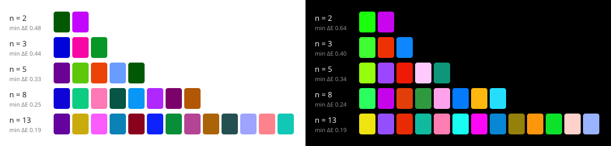

# colorcat

Generate **maximally distinct colors** for categorical data palettes (chart series,
legend entries, cluster labels).

```python
>>> from colorcat import palette
>>> palette(5)
['#740281', '#6ec409', '#fe646e', '#179afe', '#025903']
>>> palette(8, background="black")
```



- Colors are chosen to maximize the smallest perceptual distance between any two of
  them **and** between each of them and the background.
- Deterministic: the same arguments and `seed` always give the same palette.
- NumPy is the only dependency. Python 3.12+.

## Install

```sh
uv add colorcat        # once published; from a checkout: uv sync
```

## Usage

```python
from colorcat import palette, min_distance

palette(6)  # on a white background (the default)
palette(6, background="black")  # lighter colors for dark backgrounds
palette(4, fixed=["#e41a1c", "#377eb8"])  # 4 NEW colors that extend two you already use
palette(4, exclude=["#00aa00"])  # keep clear of a color used elsewhere
palette(6, cvd=["deutan", "protan"])  # also distinct for red-green color blindness
palette(6, color_format="rgb")  # (r, g, b) tuples; also "oklab" and "oklch"
palette(6, seed=3)  # a different, similarly good palette

min_distance(palette(6))  # distance between the closest pair
```

### `palette(n, *, background, restart_count, exclude, fixed, cvd, color_format, seed)`

| Argument | Default | Meaning |
|---|---|---|
| `n` | | Number of colors, `>= 0`. |
| `background` | `"white"` | `"white"` or `"black"`. Chooses a lightness range that contrasts with it. Other values raise `ValueError`. |
| `restart_count` | `4` | Independent optimizer runs (each followed by 16 basin-hopping moves); the best is kept. More is never worse, just slower (roughly 1-3.5 s for 4 at `n` up to 30). |
| `exclude` | `()` | Hex colors the new colors must stay distinct from. Not returned. |
| `fixed` | `()` | Hex colors already in use; the `n` new colors extend them. Never moved or returned, and exempt from the built-in ranges. |
| `cvd` | `()` | One or more of `"protan"`, `"deutan"`, `"tritan"` (or a single name). Every pair must then be distinct to normal vision *and* as seen with each deficiency (full dichromacy, Machado et al. 2009 simulation). The closest-pair distance drops as views are added, more so for larger `n`. |
| `color_format` | `"hex"` | `"hex"` (`"#rrggbb"`), `"rgb"` (0-255 ints), `"oklab"` (L, a, b) or `"oklch"` (L, C, h in degrees). |
| `seed` | `0` | Seed for the random starting points; `None` uses fresh entropy. |

Colors come back ordered so that the first is the most distant from the background and
each next one is the farthest from those before it. Each `n` is optimized separately, so
`palette(4)` is **not** the first four colors of `palette(5)`.

`palette` warns (it does not fail) if the closest pair differs by less than ΔE_OK 0.03,
which happens only for very large `n`.

### `min_distance(colors, *, cvd=())`

ΔE_OK between the two closest colors of a list of hex strings (`inf` for fewer than two).
With `cvd`, the closest pair over normal vision and each listed deficiency.

### Command line

```sh
colorcat 8 --background black
colorcat 4 --fixed '#e41a1c' '#377eb8' --format rgb
python -m colorcat 6 --seed 3
```

## How it works

- **Color space:** [OKLab](https://bottosson.github.io/posts/oklab/), where Euclidean
  distance (ΔE_OK) approximates perceived difference. The conversions are implemented
  directly in NumPy.
- **Constraints:** each background has a built-in range. On white, lightness is
  0.40-0.75; on black, 0.60-0.90. This keeps marks clearly separated from the background
  and away from pure white or black. Chroma has no floor or ceiling of its own and is
  limited only by the sRGB gamut. (Maximizing distance pushes colors toward high chroma,
  so greys are rare except at large `n`.)
- **Optimization:** colors are particles repelled from each other and from fixed anchors
  (the background, `fixed` and `exclude`) by the Riesz energy
  `E_p = (1/p) log Σ d_ij^-p`, which tends to the max-min distance as `p` grows.
  Projected gradient descent with a `p` schedule of 4, 8, 16, 32 minimizes it,
  restricted to the feasible region. The landscape has local optima, so it is restarted
  from `restart_count` random starts (each with its own child of `SeedSequence(seed)`).
  After its first descent, each restart does 16 basin-hopping moves: re-seed one of the
  colors in the closest pair at the roomiest spot, re-descend (`p` = 16, 32), and keep the
  result only if the closest-pair distance improved.
- **Quantization:** the best restart is chosen after snapping to 8-bit sRGB, so the
  reported distances are those of the colors you actually get.

### Quality

`benchmarks/benchmark.py` compares `palette` with random feasible colors, greedy
farthest-point sampling and Okabe-Ito / Tableau 10 / Set1. On white, the smallest
pairwise ΔE_OK (including the background) is:

| n | colorcat | farthest-point | random | best named palette |
|---|---|---|---|---|
| 5 | 0.33 | 0.31 | 0.07 | 0.17 |
| 10 | 0.22 | 0.19 | 0.04 | 0.08 |
| 20 | 0.17 | 0.13 | 0.02 | |
| 30 | 0.14 | 0.11 | 0.02 | |

Results vary by about 5% across seeds at small `n`.

## Not in v1

Planned for later: user-set lightness, chroma and hue ranges; arbitrary backgrounds
(mid-tone backgrounds will need an explicit lightness range); a WCAG contrast option;
partial-severity CVD (`cvd=` simulates full dichromacy); and alternative methods (farthest-point,
which gives prefix-stable palettes).

## Development

```sh
uv sync
uv run pytest                              # ~30 s
uv run python benchmarks/benchmark.py      # quality vs. baselines
uv run python benchmarks/make_gallery.py   # regenerate docs/gallery.svg
```

Layout: `_oklab.py` (conversions), `_distance.py` (the single distance definition),
`_constraints.py` (built-in ranges), `_feasible.py` (gamut and projection),
`_energy.py` (optimizer), `_format.py` (parsing, quantization, formats),
`palette.py` (public API), `cli.py`. See [`plan.md`](https://github.com/dpmccabe/colorcat/blob/main/plan.md) for the design.
