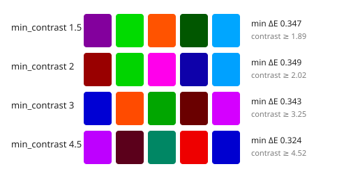
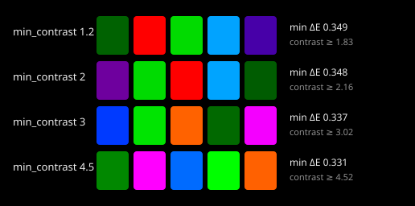

# `palette(5)` by `min_contrast`

Generated by `benchmarks/contrast.py`. `min ΔE` is the distance between the closest pair of colors (ΔE_OK, higher is better); `contrast` is the smallest WCAG contrast ratio between a color and the background. The default is `min_contrast=3`.

## White background

## Black background

