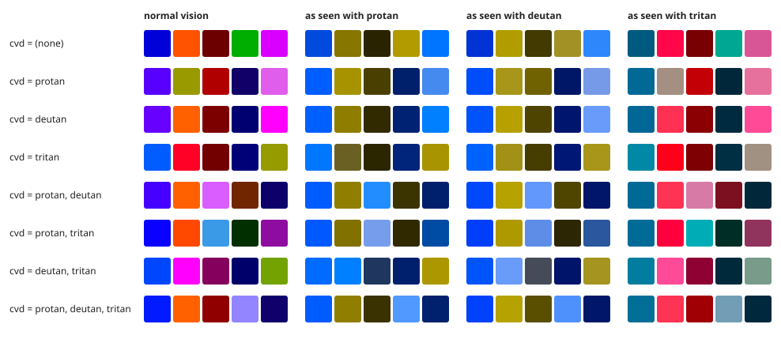

# CVD options: n=5, white background

Generated 2026-11-16 with `benchmarks/cvd.py` (restart_count=32, 3 seeds, Python 3.12.12, 407 s).

Smallest pairwise ΔE_OK between any two colors or a color and the background, mean over seeds. Bold = a view the optimizer was asked to protect. *design* is the worst of the requested views (normal vision always counts), and *vs. none* compares it with the unconstrained palette.

| `cvd` | design | vs. none | normal | protan | deutan | tritan | colors (seed 0) |
|---|---|---|---|---|---|---|---|
| (none) | 0.344 | 100% | **0.344** | 0.130 | 0.052 | 0.167 | `#0000d4` `#ff4b00` `#01a600` `#6a0000` `#d500ff` |
| protan | 0.286 | 83% | **0.287** | **0.286** | 0.168 | 0.185 | `#5800ff` `#989a00` `#b10000` `#110068` `#e15deb` |
| deutan | 0.298 | 87% | **0.298** | 0.175 | **0.298** | 0.090 | `#6700ff` `#ff6000` `#7d0000` `#000070` `#ff00ff` |
| tritan | 0.287 | 84% | **0.288** | 0.188 | 0.019 | **0.287** | `#015dff` `#ff0027` `#720000` `#000077` `#969b00` |
| protan, deutan | 0.276 | 80% | **0.276** | **0.276** | **0.276** | 0.110 | `#4600ff` `#ff6100` `#d95dff` `#712600` `#0d006a` |
| protan, tritan | 0.266 | 77% | **0.268** | **0.267** | 0.192 | **0.267** | `#0900ff` `#ff4800` `#3a9ae8` `#022f00` `#8f0ca1` |
| deutan, tritan | 0.276 | 80% | **0.288** | 0.104 | **0.278** | **0.276** | `#0046ff` `#ff00ff` `#85005c` `#00006b` `#73a301` |
| protan, deutan, tritan | 0.263 | 76% | **0.266** | **0.266** | **0.266** | **0.263** | `#001bff` `#ff6100` `#900000` `#9384ff` `#0f006b` |

Each row is one `cvd` setting; the columns are the same palette as seen with normal vision and simulated for each deficiency (Machado et al. 2009, full dichromacy).
