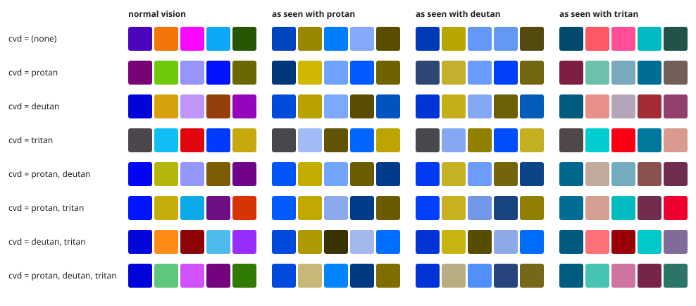

# CVD options: n=5, white background

Generated 2026-11-10 with `benchmarks/cvd.py` (restart_count=32, 3 seeds, Python 3.12.12, 474 s).

Smallest pairwise ΔE_OK between any two colors or a color and the background, mean over seeds. Bold = a view the optimizer was asked to protect. *design* is the worst of the requested views (normal vision always counts), and *vs. none* compares it with the unconstrained palette.

| `cvd` | design | vs. none | normal | protan | deutan | tritan | colors (seed 0) |
|---|---|---|---|---|---|---|---|
| (none) | 0.339 | 100% | **0.339** | 0.175 | 0.036 | 0.104 | `#4b04ba` `#f47507` `#f907fe` `#0ba8f5` `#265603` |
| protan | 0.277 | 82% | **0.280** | **0.277** | 0.212 | 0.088 | `#780376` `#6dc90a` `#9794fe` `#0112fe` `#6a6705` |
| deutan | 0.251 | 74% | **0.252** | 0.152 | **0.251** | 0.110 | `#0104d9` `#d6a10d` `#bf95f9` `#95400c` `#9604bc` |
| tritan | 0.267 | 79% | **0.276** | 0.084 | 0.147 | **0.267** | `#4e464e` `#0fbef4` `#e3050d` `#003afe` `#c8a90d` |
| protan, deutan | 0.247 | 73% | **0.251** | **0.251** | **0.247** | 0.104 | `#0005f4` `#b3b60d` `#9497fe` `#7e5c05` `#700389` |
| protan, tritan | 0.254 | 75% | **0.260** | **0.260** | 0.165 | **0.254** | `#0015fe` `#c5ae0c` `#0daae9` `#6f0e84` `#d73304` |
| deutan, tritan | 0.239 | 70% | **0.246** | 0.150 | **0.239** | **0.243** | `#0107d8` `#fe8b15` `#8b0305` `#4dbbeb` `#982efe` |
| protan, deutan, tritan | 0.229 | 67% | **0.237** | **0.235** | **0.229** | **0.231** | `#0104d9` `#5ec77d` `#d151fe` `#75037e` `#317a03` |

Each row is one `cvd` setting; the columns are the same palette as seen with normal vision and simulated for each deficiency (Machado et al. 2009, full dichromacy).
